# Spring Boot 애플리케이션 운영 기반 구성

## 1. 도입 배경

AWS EKS 기반의 금융서비스 운영환경을 구축하기 위해 애플리케이션의 기본 구조부터 배포 자동화, 상태 확인, 모니터링 및 환경별 설정 관리를 고려하였다.

애플리케이션이 단순히 정상적으로 실행되는 것뿐 아니라 운영 도구가 서비스 상태를 확인하고, 장애를 감지하며, 실행 환경에 따라 동일한 빌드 산출물을 사용할 수 있도록 구성하는 것을 목표로 한다.

## 2. 기술 선정

| 기술 | 선정 이유 |
|---|---|
| Java 21 | Java 기반 애플리케이션 개발 및 실행환경 표준화 |
| Gradle Wrapper | 개발환경과 CI 환경의 빌드 도구 버전 일관성 확보 |
| Spring Profiles | 개발·운영 환경별 설정 관리 |
| Spring Boot Actuator | 애플리케이션 상태 및 운영 정보 제공 |
| Micrometer | 애플리케이션 메트릭 수집 및 Prometheus 연동 |
| Springdoc | REST API 명세 자동 생성 |
| JUnit·MockMvc | CI 파이프라인에서 실행 가능한 자동화 테스트 |

## 3. 구현 방법

### 3.1. 환경별 설정 분리

application.yml을 공통 설정으로 사용하고, application-local.yml과 application-prod.yml로 환경별 설정을 분리하였다.

SPRING_PROFILES_ACTIVE 환경변수를 통해 실행 환경을 변경하도록 구성하였다.

향후 Kubernetes Deployment와 Helm Chart에서 환경별 설정을 관리할 예정이다.

### 3.2. Health Check

- /api/health: 애플리케이션 API 연결 확인
- /actuator/health: 애플리케이션 종합 상태 확인
- /actuator/health/liveness: 프로세스 상태 확인
- /actuator/health/readiness: 트래픽 수신 가능 여부 확인

Liveness와 Readiness의 목적을 구분하여 추후 Kubernetes의 컨테이너 재시작 및 트래픽 제어에 활용하도록 구성하였다.

### 3.3. Prometheus 메트릭 제공

Micrometer와 Prometheus Registry를 통해 JVM, CPU, HTTP 요청 처리량 및 응답시간 관련 메트릭을 제공하도록 구성하였다.

메트릭 수집 경로는 /actuator/prometheus이며, 이후 Prometheus 서버와 Grafana 대시보드에 연동할 예정이다.

### 3.4. Graceful Shutdown

애플리케이션 종료 시 처리 중인 요청을 완료할 수 있도록 Graceful Shutdown을 설정하였다.

향후 Kubernetes Rolling Update 과정에서 종료 시간, readiness 상태, ALB 연결 종료 정책을 함께 설정하고 무중단 배포 실험을 수행할 예정이다.

### 3.5. 자동화 테스트

JUnit과 MockMvc를 활용하여 다음 항목을 검증할 수 있도록 테스트를 작성하였다.

- Spring Boot 애플리케이션 컨텍스트 초기화
- Health Check API 응답
- Liveness 및 Readiness 엔드포인트
- Prometheus 메트릭 엔드포인트
- 비즈니스 예외 및 입력값 검증
- 서버 내부 오류 정보 노출 방지

## 4. 기대 효과

- Gradle Wrapper를 통한 재현 가능한 빌드환경 구성
- 동일한 빌드 산출물을 활용한 환경별 배포
- Kubernetes 및 ALB 헬스체크 연동 기반 확보
- Prometheus 기반 애플리케이션 관측성 확보
- 자동화 테스트를 활용한 CI 품질 검증 기반 구성
- 운영환경에서 불필요한 API 문서 및 오류 정보 노출 제한

## 5. 검증 항목

| 검증 대상 | 검증 방법 | 결과 | 이미지 |
|---|---|---|---|
| Gradle 빌드 | ./gradlew clean build | Gradle Wrapper 기반 빌드 성공, 실행 가능한 JAR 산출물 생성 확인  |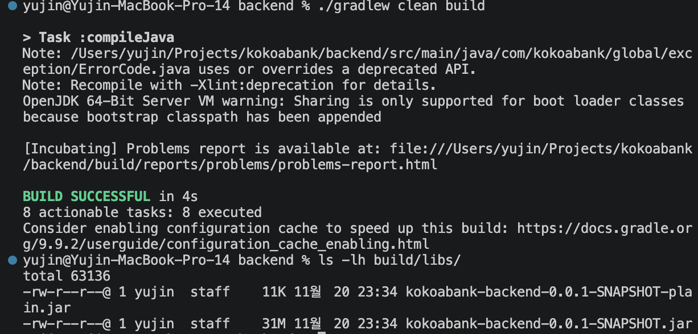 |
| 자동화 테스트 | ./gradlew test | JUnit·MockMvc 기반 자동화 테스트 9건 통과, 실패 0건 | 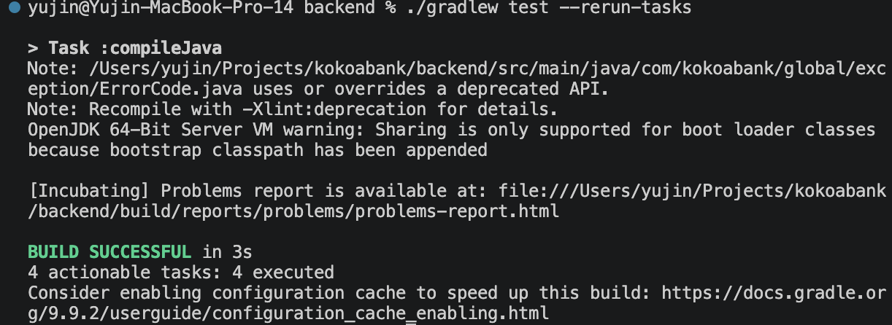 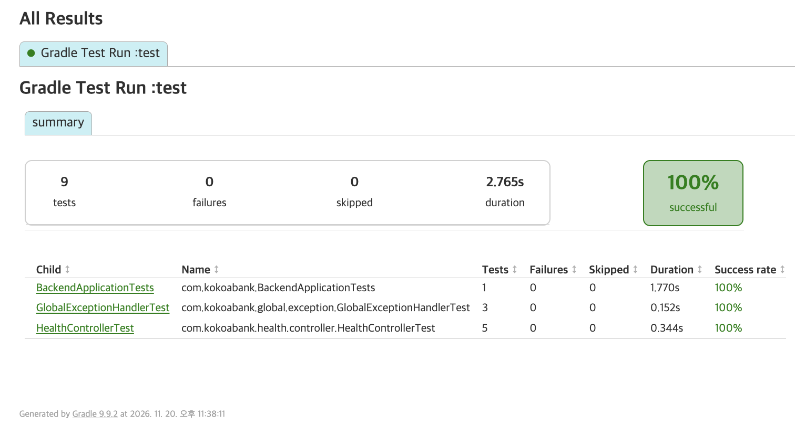 |
| Health API | curl 요청 | HTTP 200 및 서비스 상태 UP 반환 확인 | 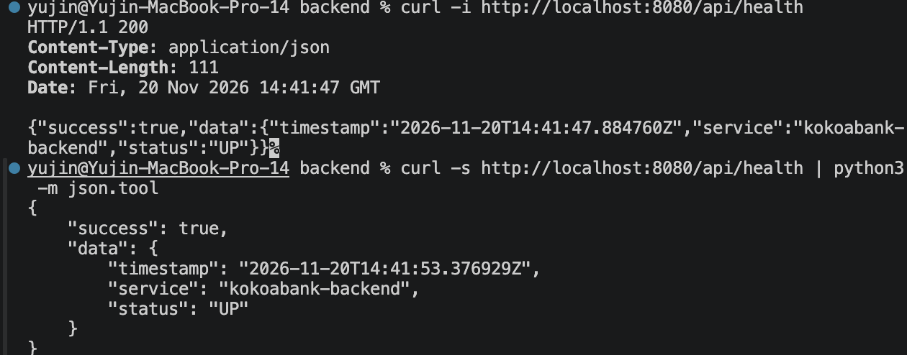 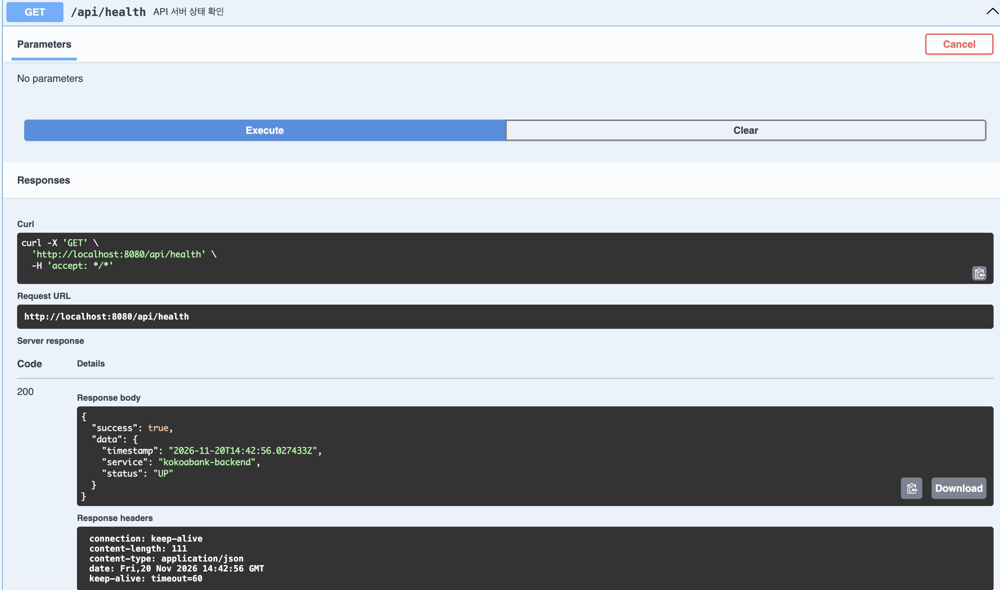|
| Liveness·Readiness | Actuator 엔드포인트 호출 | Liveness·Readiness 엔드포인트 정상 응답 확인, Kubernetes Probe 연동 기반 확보 | 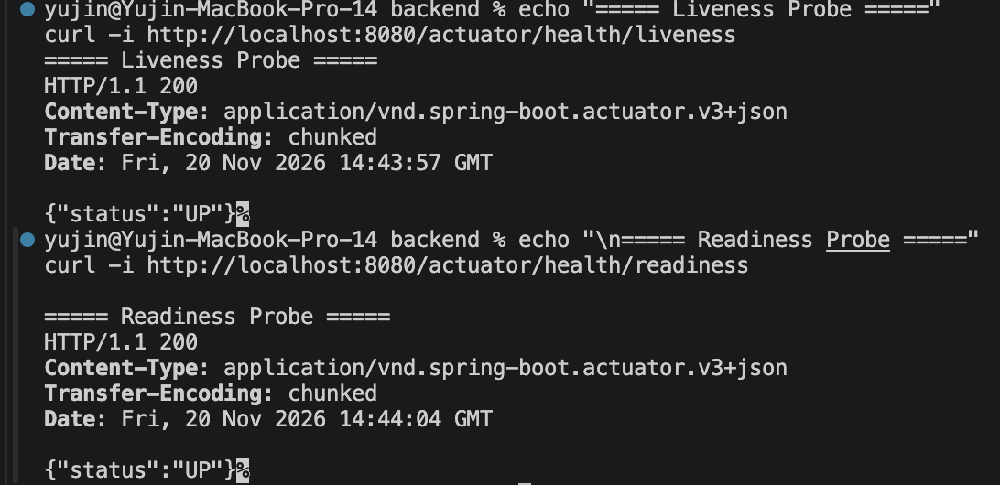 |
| Prometheus | 메트릭 엔드포인트 조회 | Micrometer 기반 JVM·CPU·HTTP 요청 및 응답시간 메트릭 생성 확인 | 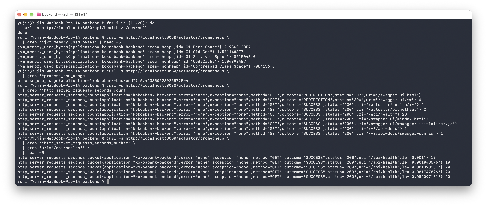 |
| 환경별 설정 | local·prod Profile 실행 비교 | 동일한 JAR 산출물을 환경변수 변경만으로 local/prod 환경에서 실행하고 환경별 설정 적용을 확인함. Build Once, Deploy Many 기반 확보 | 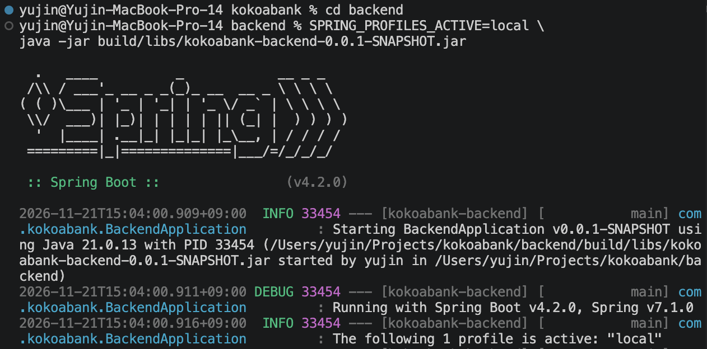 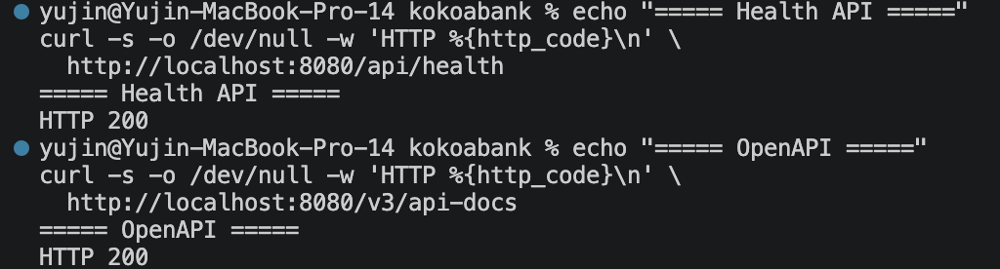 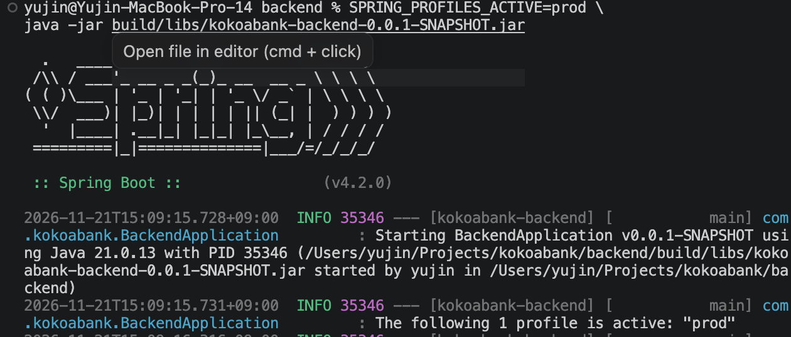 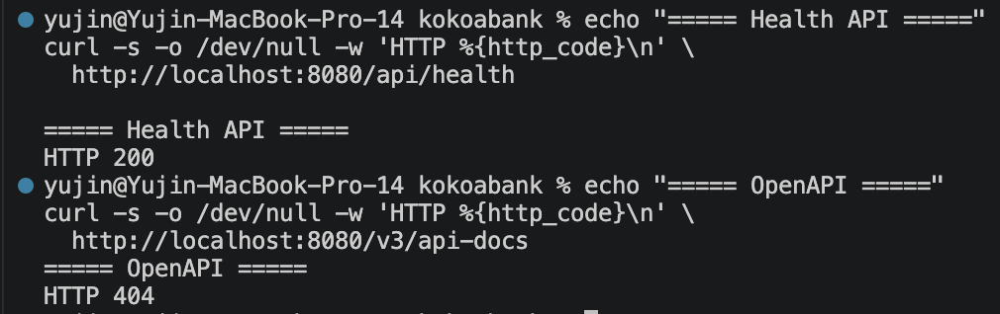|
| Vite Proxy | 프론트엔드 서버 경유 API 호출 | Vite Proxy를 통한 Spring Boot API 요청 전달 및 정상 응답 확인 | 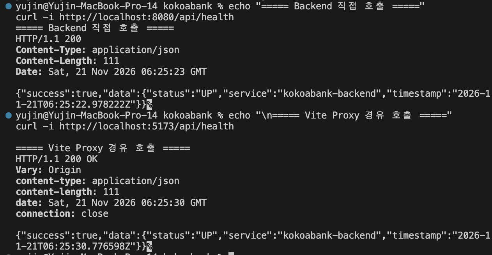 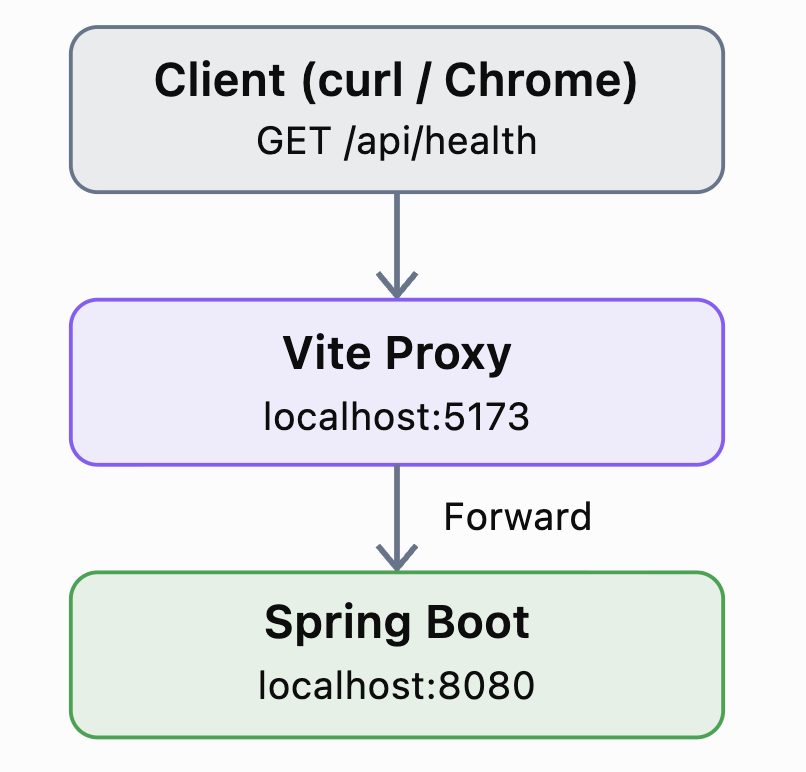 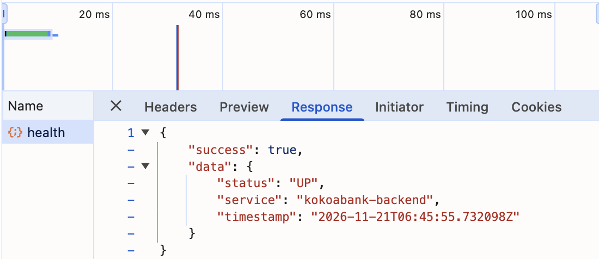 |

## 6. 향후 확장 계획

- Docker 멀티스테이지 빌드를 통한 실행환경 표준화
- GitHub Actions 및 GitLab CI의 자동 빌드·테스트
- AWS EKS와 Kubernetes Probe 연동
- Helm 기반 환경별 설정 관리
- Prometheus·Grafana 모니터링 구축
- ALB 및 Rolling Update를 활용한 무중단 배포 검증
- 부하 테스트를 통한 응답시간·오류율 측정

## 7. 참고 자료

- Spring Boot Actuator: https://docs.spring.io/spring-boot/3.5/reference/actuator/endpoints.html
- Springdoc OpenAPI: https://springdoc.org/v2/
- Kubernetes Documentation: https://kubernetes.io/docs/

## 트러블슈팅: Prometheus 엔드포인트 테스트 404 오류

### 문제
MockMvc를 활용한 /actuator/prometheus 호출 테스트에서
HTTP 200이 아닌 404 응답이 반환됨.

### 원인
@SpringBootTest 환경에서는 외부 메트릭 시스템의
MeterRegistry가 기본적으로 자동 구성되지 않음.

### 해결
- spring-boot-micrometer-metrics-test 의존성 추가
- @AutoConfigureMetrics 어노테이션 적용

### 검증
- Prometheus 엔드포인트 개별 테스트
- 전체 Gradle 테스트 재실행

### 배운 점
실제 애플리케이션 실행환경과 테스트 환경의
자동 구성 방식에 차이가 존재한다.
운영 기능을 CI 환경에서 검증하려면 테스트 환경의
자동 구성 조건도 고려해야 한다.