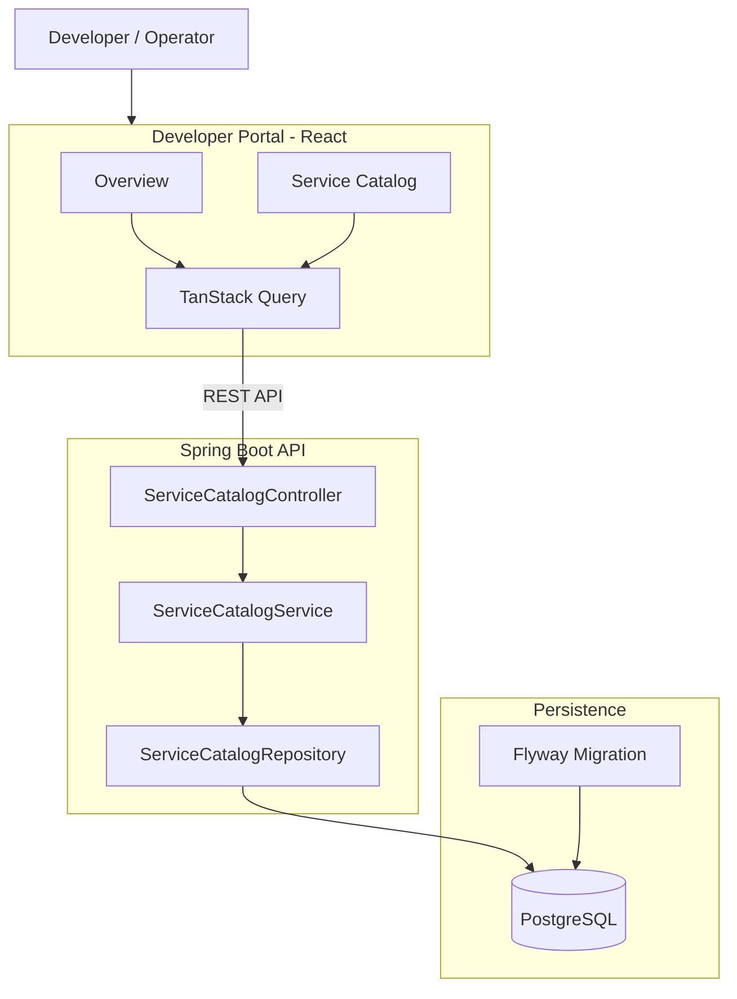
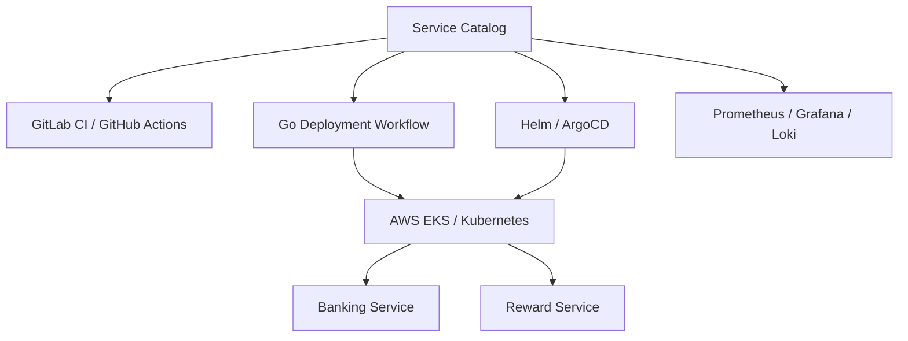
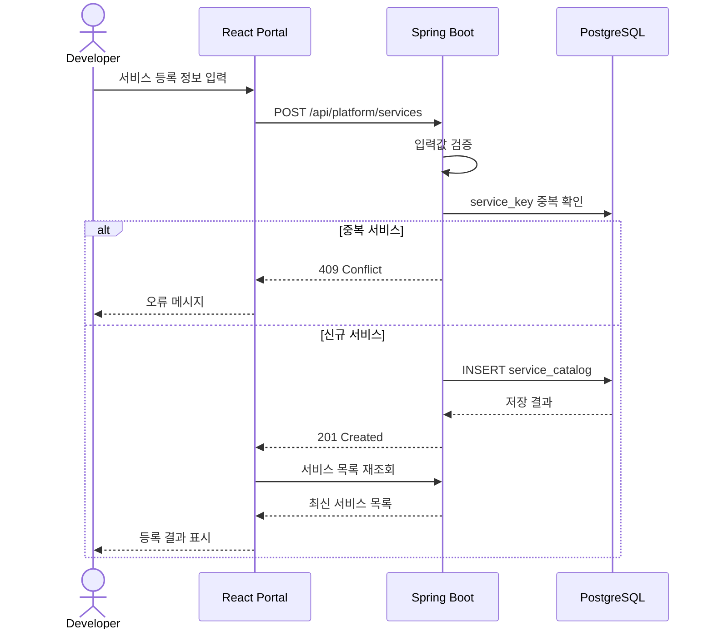

# Developer Portal & Service Catalog

## 1. 개요

KokoaBank는 금융서비스의 개발·배포·운영을 지원하는 클라우드 네이티브 DevOps 플랫폼입니다.

초기 프로젝트는 가상 계좌와 이체 기능을 제공하는 은행 클론으로 구성했으나, DevOps 엔지니어링에 집중하기 위해 플랫폼 중심으로 아키텍처를 변경했습니다.

Developer Portal은 개발자가 서비스 정보를 확인하고 CI/CD, 배포, 모니터링 및 운영 업무를 수행하기 위한 통합 인터페이스입니다.

Service Catalog는 플랫폼에서 관리하는 애플리케이션의 메타데이터를 저장하고 제공하는 핵심 기능입니다.

### 목표

- 여러 금융서비스를 일관된 방식으로 등록하고 관리합니다.
- 서비스별 저장소, 유형, 담당자 등 공통 메타데이터를 관리합니다.
- CI/CD 및 GitOps 연동에 사용할 서비스 식별 체계를 정의합니다.
- 프론트엔드의 임시 데이터가 아닌 PostgreSQL 기반 영속 데이터를 사용합니다.
- 향후 Go CLI, 배포 Workflow, 모니터링 기능을 확장할 수 있는 기반을 구축합니다.

### 적용 기술

| 구분 | 기술 |
|---|---|
| Frontend | React, TypeScript, Vite, Tailwind CSS |
| UI Animation | Motion for React |
| Server State | TanStack Query |
| Backend | Java 21, Spring Boot 4.2.0 |
| Persistence | Spring Data JPA, Hibernate |
| Database | PostgreSQL |
| Schema Migration | Flyway |
| Local Infrastructure | Docker Compose |

---

## 2. 시스템 아키텍처

### 2.1 전체 구조



Developer Portal은 서비스 정보를 직접 보관하지 않고 REST API를 통해 조회합니다.

Spring Boot는 요청 검증과 비즈니스 로직을 처리하며, Spring Data JPA를 사용해 PostgreSQL에 데이터를 저장합니다.

데이터베이스 스키마는 Flyway를 통해 버전별로 관리합니다.

### 2.2 향후 확장 아키텍처

Service Catalog는 CI/CD와 배포 시스템을 연결하는 공통 서비스 식별 체계로 활용할 예정입니다.



위 다이어그램은 **확장 목표 아키텍처**입니다. Part 6A에서는 Service Catalog와 Developer Portal의 기본 기능을 구현하고, 실제 CI/CD·Kubernetes·모니터링 연동은 후속 Part에서 진행합니다.

---

## 3. Developer Portal 설계

### 3.1 화면 구성

Developer Portal은 개발자와 운영자가 공통으로 사용하는 관리 콘솔을 목표로 합니다.

| 화면 | 기능 | 구현 단계 |
|---|---|---|
| Overview | 등록된 서비스 수와 유형별 현황 조회 | Part 6A |
| Service Catalog | 서비스 등록·조회·수정·삭제 | Part 6A |
| Pipeline Center | 파이프라인 실행 및 결과 조회 | 후속 Part |
| Deployment Center | 배포 요청·승인·상태 조회·롤백 | 후속 Part |
| GitOps Dashboard | ArgoCD 애플리케이션 상태 조회 | 후속 Part |
| Observability | 메트릭·로그·트레이스 통합 조회 | 후속 Part |
| Incident Center | 장애 감지·조치·복구 이력 관리 | 후속 Part |
| Infrastructure | 클러스터·인프라 리소스 현황 | 후속 Part |

### 3.2 Overview 데이터 정책

Overview에서는 Service Catalog API로 조회한 실제 서비스 데이터만 통계에 반영합니다.

현재 제공할 수 있는 지표는 다음과 같습니다.

- 전체 등록 서비스 수
- 유형별 등록 서비스 수
- 등록된 서비스 목록

배포 성공률, 장애 건수, 실시간 서비스 상태 등은 실제 운영 도구와 연동되기 전까지 표시하지 않거나 `연동 예정`으로 구분합니다.

이를 통해 임의의 데이터를 실제 운영 지표로 오인하는 문제를 방지합니다.

### 3.3 애니메이션 설계

Developer Portal은 업무용 관리 도구이므로 시각적 효과보다 가독성과 상태 전달을 우선합니다.

Motion for React로 공통 애니메이션 컴포넌트를 구성하여 다음 영역에 적용합니다.

- 페이지 및 카드 등장
- 서비스 목록 전환
- 버튼 Hover 상태
- 향후 배포·파이프라인 상태 변화

애니메이션은 재사용 가능한 컴포넌트로 구현하고, 사용자의 `prefers-reduced-motion` 설정을 고려합니다.

애니메이션 적용이 API 결과, 배포 실행 여부 또는 사용자 권한에 영향을 주지 않도록 UI 표현과 실제 비즈니스 로직을 분리합니다.

---

## 4. Service Catalog 설계

### 4.1 도입 배경

DevOps 플랫폼에서는 동일한 애플리케이션을 여러 도구에서 관리할 수 있습니다.

예를 들어 하나의 Banking API는 Git 저장소, CI 파이프라인, 컨테이너 이미지, Helm 릴리스, ArgoCD 애플리케이션 및 모니터링 대시보드에 각각 연결됩니다.

서비스를 도구별 이름으로만 관리하면 명칭 변경이나 환경 추가 시 연계 관계를 유지하기 어렵습니다.

이를 해결하기 위해 플랫폼 내부에서 일관되게 사용할 `service_key`를 도입합니다.

### 4.2 서비스 메타데이터

| 필드 | 유형 | 설명 |
|---|---|---|
| `id` | BIGINT | 데이터베이스 기본 키 |
| `service_key` | VARCHAR(80) | 서비스 고유 식별자 |
| `name` | VARCHAR(120) | 서비스 표시 이름 |
| `description` | VARCHAR(500) | 서비스 설명 |
| `service_type` | VARCHAR(30) | 서비스 유형 |
| `repository_url` | VARCHAR(500) | Git 저장소 주소 |
| `owner` | VARCHAR(120) | 서비스 담당자 |
| `created_at` | TIMESTAMPTZ | 생성 시각 |
| `updated_at` | TIMESTAMPTZ | 최종 수정 시각 |

서비스 유형은 `BACKEND`, `FRONTEND`, `WORKER`로 구분합니다.

### 4.3 서비스 식별자 설계

`id`와 `service_key`는 서로 다른 목적을 가집니다.

**`id`**

- 데이터베이스 내부 기본 키
- 개별 서비스 레코드 조회에 사용
- 자동 생성

**`service_key`**

- 서비스에 부여하는 고유 식별자
- CI/CD, CLI, 배포 Workflow에서 사용할 공통 키
- 등록 시 중복 검사
- 등록 이후 변경 불가

예시:

```text
banking-api
reward-service
transaction-worker
developer-portal
```

`service_key`는 영문 소문자, 숫자, 하이픈을 사용하는 형태로 제한합니다.

서비스 표시 이름은 변경할 수 있지만, 다른 시스템에서 참조할 가능성이 높은 `service_key`는 변경하지 않도록 설계했습니다.

### 4.4 데이터베이스 제약조건

데이터베이스에는 다음 규칙을 적용합니다.

- `id`: Primary Key
- `service_key`: NOT NULL, UNIQUE
- `name`: NOT NULL
- `service_type`: NOT NULL
- `service_type`: 허용된 유형만 저장하도록 CHECK 제약조건 적용

`service_type`에는 조회를 위한 인덱스를 생성합니다.

중복 서비스 등록 시 애플리케이션에서 사전 검증을 수행하지만, 동시 요청으로 인한 경쟁 상태까지 방지하려면 데이터베이스의 UNIQUE 제약조건이 필요합니다.

---

## 5. REST API 설계

### 5.1 엔드포인트

기본 경로는 `/api/platform/services`입니다.

| Method | Endpoint | 설명 |
|---|---|---|
| GET | `/api/platform/services` | 서비스 전체 조회 |
| GET | `/api/platform/services/{id}` | 서비스 상세 조회 |
| POST | `/api/platform/services` | 신규 서비스 등록 |
| PUT | `/api/platform/services/{id}` | 서비스 정보 수정 |
| DELETE | `/api/platform/services/{id}` | 서비스 삭제 |

### 5.2 서비스 등록 요청

```http
POST /api/platform/services
Content-Type: application/json
```

```json
{
  "serviceKey": "banking-api",
  "name": "Banking API",
  "description": "Virtual banking workload for reliability testing",
  "serviceType": "BACKEND",
  "repositoryUrl": "",
  "owner": "KokoaBank"
}
```

정상 등록 시 HTTP `201 Created`를 반환하도록 설계합니다.

### 5.3 서비스 조회 응답 예시

```json
{
  "id": 1,
  "serviceKey": "banking-api",
  "name": "Banking API",
  "description": "Virtual banking workload for reliability testing",
  "serviceType": "BACKEND",
  "repositoryUrl": "",
  "owner": "KokoaBank",
  "createdAt": "2026-11-25T00:00:00Z",
  "updatedAt": "2026-11-25T00:00:00Z"
}
```

위 응답은 API 형식을 설명하기 위한 예시이며 실제 데이터베이스의 실행 결과가 아닙니다.

### 5.4 오류 처리

| 상황 | 예상 HTTP 상태 |
|---|---|
| 정상 등록 | 201 Created |
| 정상 조회·수정 | 200 OK |
| 정상 삭제 | 204 No Content |
| 잘못된 요청 필드 | 400 Bad Request |
| `service_key` 변경 시도 | 400 Bad Request |
| 존재하지 않는 서비스 | 404 Not Found |
| 중복 `service_key` 등록 | 409 Conflict |

실제 응답 코드가 기존 공통 예외 처리기에 의해 변경되지 않는지 API 테스트로 확인해야 합니다.

또한 `existsByServiceKey()`를 이용한 사전 중복 검사는 동시 등록 요청을 완전히 방지하지 못하므로, DB UNIQUE 위반 예외를 HTTP 409로 일관되게 변환하는 보완이 필요합니다.

---

## 6. 데이터 처리 흐름

### 6.1 서비스 등록



### 6.2 프론트엔드 데이터 동기화

프론트엔드에서는 TanStack Query를 사용하여 서버 데이터를