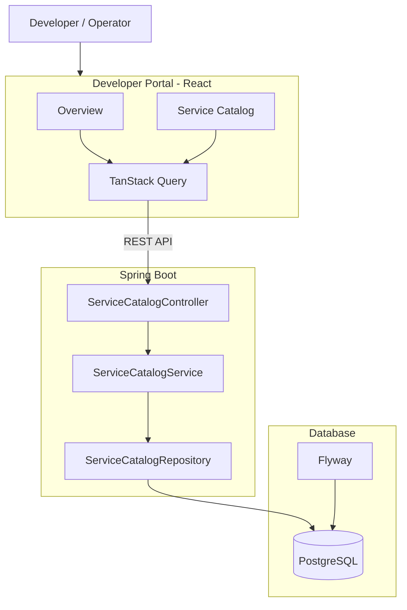
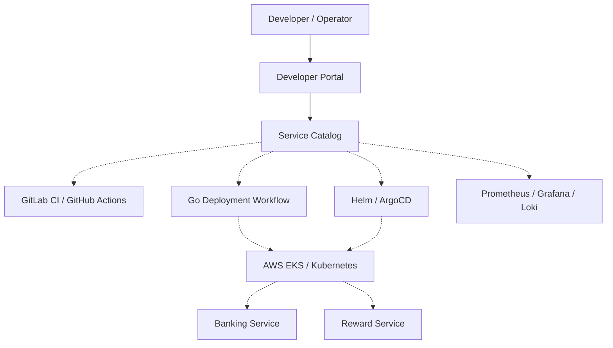

# Developer Portal 및 Service Catalog 설계·구현

## 1. 개요

KokoaBank는 금융서비스의 개발·배포·운영을 자동화하기 위한 클라우드 네이티브 DevOps 플랫폼이다.

초기에는 가상 계좌 개설, 계좌이체, 거래내역 조회 기능을 제공하는 은행 클론 프로젝트로 시작하였다. 이후 프로젝트의 핵심 목표를 금융 애플리케이션 개발이 아닌 DevOps 플랫폼 구축으로 재정의하였다.

이에 따라 기존 은행 서비스는 플랫폼의 배포·운영 및 안정성 검증을 위한 워크로드로 활용하고, 개발자에게 필요한 서비스 관리·CI/CD·배포 Workflow·모니터링 기능을 통합하는 Developer Portal을 구축하기로 하였다.

Part 6A에서는 Developer Portal의 기본 구조와 Service Catalog를 구현하였다. Service Catalog는 플랫폼에서 관리하는 애플리케이션의 메타데이터를 저장하고, 향후 배포 자동화 도구들이 동일한 서비스 식별자를 사용할 수 있도록 지원한다.

### 1.1 구현 목표

- 개발자와 운영자를 위한 통합 관리 인터페이스 구축
- 금융 애플리케이션의 서비스 메타데이터 관리
- 서비스 등록·조회·수정·삭제 REST API 구현
- PostgreSQL 기반 데이터 영속성 확보
- CI/CD·GitOps·배포 Workflow 연계를 위한 서비스 식별 체계 정의
- 실제 데이터에 기반한 Developer Portal 대시보드 구성
- 재사용 가능한 UI 애니메이션 적용

### 1.2 기술 스택

| 구분 | 기술 | 적용 목적 |
|---|---|---|
| Frontend | React, TypeScript, Vite | 개발자 포털 UI 구축 |
| Styling | Tailwind CSS | 반응형 레이아웃 및 공통 스타일 |
| Animation | Motion for React | 페이지 및 컴포넌트 전환 |
| Server State | TanStack Query | API 데이터 조회·캐시·동기화 |
| Backend | Java 21, Spring Boot 4.2.0 | REST API 및 비즈니스 로직 |
| Persistence | Spring Data JPA, Hibernate | 데이터 접근 및 영속성 관리 |
| Database | PostgreSQL | 서비스 메타데이터 저장 |
| Migration | Flyway | 데이터베이스 스키마 버전 관리 |
| Local Infrastructure | Docker Compose | 로컬 개발 인프라 실행 |

---

## 2. 시스템 아키텍처

### 2.1 전체 아키텍처



Developer Portal은 서비스 메타데이터를 직접 보관하지 않고 Spring Boot REST API를 통해 조회하도록 구성하였다.

백엔드는 Controller, Service, Repository 계층으로 분리하였다. Controller는 HTTP 요청과 입력값 검증을 담당하고, Service는 서비스 등록 및 변경에 필요한 비즈니스 규칙을 처리한다. Repository는 Spring Data JPA를 통해 PostgreSQL에 접근한다.

데이터베이스 스키마는 Flyway를 활용하여 버전별로 관리하였다.

이러한 구조를 통해 프론트엔드와 데이터 저장 계층의 결합도를 낮추고, 향후 외부 DevOps 도구와의 연동 기능을 추가할 수 있도록 하였다.

### 2.2 확장 아키텍처

Service Catalog는 향후 CI/CD, GitOps, 배포 Workflow, 모니터링 시스템을 연결하는 공통 서비스 식별 체계로 활용한다.



점선은 후속 개발 단계에서 구현할 연계 관계를 나타낸다.

Part 6A에서는 Service Catalog와 Developer Portal의 기본 기능을 구축하였으며, CI/CD·Kubernetes·ArgoCD·모니터링 연동은 후속 단계에서 구현한다.

---

## 3. Developer Portal 설계

### 3.1 도입 배경

금융서비스를 운영하는 환경에서는 애플리케이션의 소스코드 관리, 빌드, 테스트, 배포, 모니터링 등 여러 작업이 서로 다른 도구에서 수행된다.

개발자는 GitLab에서 파이프라인을 확인하고, ArgoCD에서 배포 상태를 조회하며, Grafana에서 서비스 지표를 분석해야 할 수 있다.

이러한 도구가 독립적으로 운영될 경우 서비스별 상태를 파악하거나 배포 작업을 수행하기 위해 여러 시스템을 이동해야 하는 불편함이 발생한다.

이를 개선하기 위해 Developer Portal을 도입하였다.

Developer Portal은 기존 DevOps 도구의 기능을 모두 직접 재구현하는 것이 아니라, 각 도구의 정보를 서비스 단위로 연결하고 공통 작업을 자동화하는 인터페이스를 제공하는 것을 목표로 한다.

### 3.2 화면 구성

| 화면 | 주요 기능 | 구현 단계 |
|---|---|---|
| Overview | 등록 서비스 및 기본 현황 조회 | Part 6A |
| Service Catalog | 서비스 등록·조회·수정·삭제 | Part 6A |
| Pipeline Center | CI 실행·결과·이력 조회 | 후속 구현 |
| Deployment Center | 배포 요청·승인·실행·롤백 | 후속 구현 |
| GitOps Dashboard | ArgoCD 애플리케이션 상태 조회 | 후속 구현 |
| Observability | 메트릭·로그·분산 추적 통합 조회 | 후속 구현 |
| Incident Center | 장애 탐지·조치·복구 이력 관리 | 후속 구현 |
| Infrastructure | Kubernetes·AWS 리소스 현황 조회 | 후속 구현 |

### 3.3 Overview 데이터 설계

Overview는 Service Catalog API를 통해 조회한 데이터를 기준으로 통계 정보를 구성하였다.

현재 단계에서 제공하는 주요 정보는 다음과 같다.

- 전체 등록 서비스 수
- Backend 유형 서비스 수
- 등록된 서비스 목록
- 서비스 이름 및 유형

배포 성공률, 장애 건수, 실시간 서비스 상태 등은 외부 DevOps 도구와 연동되어야 정확하게 측정할 수 있다.

따라서 실제 데이터가 존재하지 않는 지표를 임의로 생성하지 않고 `연동 예정` 상태로 표시하도록 설계하였다.

이를 통해 개발 단계의 예시 데이터가 실제 운영 지표로 오인되는 문제를 방지하였다.

### 3.4 UI 및 애니메이션

Developer Portal은 운영 업무를 수행하는 관리 도구이므로 가독성과 정보 전달을 우선하였다.

Motion for React를 사용하여 페이지와 카드에 공통 등장 애니메이션을 적용하였다.

`FadeIn` 컴포넌트를 별도로 구성하여 여러 화면에서 재사용하도록 하였으며, 컴포넌트마다 애니메이션 로직을 중복 작성하지 않도록 하였다.

또한 사용자의 모션 감소 설정을 고려하여 불필요한 움직임을 최소화하도록 설계하였다.

애니메이션은 화면 표현에만 사용하고, 실제 API 요청 결과나 서비스 상태에 영향을 주지 않도록 비즈니스 로직과 분리하였다.

---

## 4. Service Catalog 설계

### 4.1 도입 배경

DevOps 플랫폼에서는 하나의 애플리케이션이 여러 시스템에서 관리된다.

예를 들어 Banking API는 다음과 같은 리소스와 연결될 수 있다.

- Git 저장소
- CI/CD 파이프라인
- 컨테이너 이미지
- Helm 릴리스
- ArgoCD 애플리케이션
- Kubernetes Deployment
- 모니터링 대시보드

각 시스템에서 서로 다른 이름이나 식별자를 사용할 경우 서비스 간 연계 관계를 관리하기 어렵다.

이를 해결하기 위해 Service Catalog에 고유한 `service_key`를 부여하였다.

해당 식별자를 기준으로 향후 CI/CD, 배포 Workflow, 운영 도구를 연결할 수 있도록 설계하였다.

### 4.2 데이터 모델

Service Catalog 데이터는 PostgreSQL의 `service_catalog` 테이블에 저장한다.

| 컬럼 | 데이터 타입 | 제약조건 | 설명 |
|---|---|---|---|
| `id` | BIGSERIAL | PRIMARY KEY | 내부 식별자 |
| `service_key` | VARCHAR(80) | NOT NULL, UNIQUE | 서비스 고유 키 |
| `name` | VARCHAR(120) | NOT NULL | 서비스 이름 |
| `description` | VARCHAR(500) | - | 서비스 설명 |
| `service_type` | VARCHAR(30) | NOT NULL, CHECK | 서비스 유형 |
| `repository_url` | VARCHAR(500) | - | 소스코드 저장소 주소 |
| `owner` | VARCHAR(120) | - | 담당자 |
| `created_at` | TIMESTAMPTZ | NOT NULL | 생성 시각 |
| `updated_at` | TIMESTAMPTZ | NOT NULL | 수정 시각 |

서비스 유형은 `BACKEND`, `FRONTEND`, `WORKER`로 구분하였다.

서비스 유형별 조회를 고려하여 `service_type` 컬럼에 인덱스를 구성하였다.

### 4.3 서비스 식별자

Service Catalog에서는 `id`와 `service_key`를 구분하여 사용한다.

**`id`**

데이터베이스에서 자동 생성하는 기본 키이다. 개별 서비스 레코드를 조회하고 수정·삭제하는 데 사용한다.

**`service_key`**

플랫폼 전체에서 서비스를 식별하기 위한 논리적 키이다. CI/CD 파이프라인, 배포 Workflow, CLI 등에서 공통으로 활용할 수 있도록 설계하였다.

예시:

```text
banking-api
reward-service
transaction-worker
developer-portal
```

`service_key`는 영문 소문자, 숫자, 하이픈으로 구성하도록 제한하였다.

또한 서비스 등록 이후에는 `service_key`를 변경하지 못하도록 하였다.

이는 서비스 이름이 변경되더라도 외부 시스템에서 사용하는 식별자의 안정성을 유지하기 위한 결정이다.

### 4.4 데이터 정합성

서비스 등록 시 동일한 `service_key`가 존재하는지 확인하도록 구현하였다.

그러나 애플리케이션 레벨의 중복 검증만으로는 동시 요청에 따른 경쟁 상태를 완전히 방지할 수 없다.

예를 들어 두 요청이 동시에 같은 `service_key`의 존재 여부를 검사하면 모두 등록 가능하다고 판단할 수 있다.

따라서 PostgreSQL에 UNIQUE 제약조건을 설정하여 데이터베이스에서도 중복을 차단하도록 하였다.

DB 제약조건 위반을 일관된 HTTP 409 응답으로 변환하는 처리는 공통 예외 처리 정책과 함께 검증·보완해야 한다.

---

## 5. REST API 구현

### 5.1 API 엔드포인트

Service Catalog의 기본 경로는 `/api/platform/services`이다.

| Method | Endpoint | 기능 | 정상 응답 |
|---|---|---|---|
| GET | `/api/platform/services` | 전체 서비스 조회 | 200 |
| GET | `/api/platform/services/{id}` | 서비스 상세 조회 | 200 |
| POST | `/api/platform/services` | 서비스 등록 | 201 |
| PUT | `/api/platform/services/{id}` | 서비스 수정 | 200 |
| DELETE | `/api/platform/services/{id}` | 서비스 삭제 | 204 |

### 5.2 계층별 책임

백엔드는 다음 계층으로 구성하였다.

```text
ServiceCatalogController
          ↓
ServiceCatalogService
          ↓
ServiceCatalogRepository
          ↓
       PostgreSQL
```

**Controller**

HTTP 요청을 수신하고 요청 DTO의 유효성을 검증한다. Service 계층에서 반환한 결과를 HTTP 응답으로 변환한다.

**Service**

서비스 등록·수정·삭제에 필요한 비즈니스 규칙을 처리한다. 등록 시 중복 여부를 확인하고, 수정 시 서비스 식별자 변경을 제한한다.

**Repository**

Spring Data JPA를 활용하여 서비스 메타데이터를 조회하고 저장한다.

**DTO**

API 요청과 응답의 구조를 정의한다. 영속성 Entity를 외부에 직접 노출하지 않도록 분리하였다.

### 5.3 트랜잭션 관리

조회 기능에는 읽기 전용 트랜잭션을 적용하고, 등록·수정·삭제 기능에는 쓰기 트랜잭션을 적용하였다.

이를 통해 데이터 변경 작업을 하나의 트랜잭션 경계 안에서 처리하도록 구성하였다.

서비스 수정 시에는 영속성 컨텍스트의 변경 감지를 이용하여 수정된 필드를 데이터베이스에 반영한다.

### 5.4 요청 예시

```http
POST /api/platform/services
Content-Type: application/json
```

```json
{
  "serviceKey": "banking-api",
  "name": "Banking API",
  "description": "Virtual banking workload for reliability testing",
  "serviceType": "BACKEND",
  "repositoryUrl": "",
  "owner": "KokoaBank"
}
```

### 5.5 응답 예시

```json
{
  "id": 1,
  "serviceKey": "banking-api",
  "name": "Banking API",
  "description": "Virtual banking workload for reliability testing",
  "serviceType": "BACKEND",
  "repositoryUrl": "",
  "owner": "KokoaBank",
  "createdAt": "2026-11-25T00:00:00Z",
  "updatedAt": "2026-11-25T00:00:00Z"
}
```

위 데이터는 응답 형식 설명을 위한 예시이며 실제 실행 결과는 아니다.

### 5.6 오류 처리

| 오류 상황 | HTTP 상태 |
|---|---|
| 잘못된 요청 데이터 | 400 Bad Request |
| 서비스 식별자 변경 시도 | 400 Bad Request |
| 존재하지 않는 서비스 | 404 Not Found |
| 중복 서비스 등록 | 409 Conflict |

서비스 계층에서는 예외 발생 조건을 정의하고, Controller 및 공통 예외 처리 계층을 통해 적절한 HTTP 상태를 반환하도록 구성하였다.

실제 상태 코드가 기존 공통 예외 처리기에 의해 변경되지 않는지 통합 테스트에서 검증해야 한다.

---

## 6. 프론트엔드 구현

### 6.1 API 데이터 관리

Developer Portal에서는 TanStack Query를 활용하여 서버 데이터를 관리하였다.

서비스 목록 조회 시 API 응답을 캐시에 저장하며, 등록·수정·삭제 작업이 성공하면 관련 쿼리를 무효화하여 최신 데이터를 다시 조회한다.

```typescript
queryClient.invalidateQueries({
  queryKey: ['services'],
});
```

이를 통해 프론트엔드 상태를 직접 조작하는 방식보다 서버 데이터를 일관되게 반영할 수 있도록 하였다.

### 6.2 Service Catalog 화면

Service Catalog는 다음 기능을 제공하도록 구성하였다.

- 서비스 목록 조회
- 서비스 이름 및 식별자 검색
- 서비스 유형별 필터링
- 서비스 등록 모달
- 서비스 정보 수정
- 서비스 삭제
- API 오류 메시지 표시

서비스 등록·수정·삭제 작업은 실제 REST API를 호출하도록 구현하였다.

화면 새로고침 이후에도 등록된 서비스 정보가 유지되도록 PostgreSQL 기반 영속 데이터를 사용하였다.

### 6.3 재사용 가능한 UI 구조

Developer Portal은 앞으로 다양한 관리 기능이 추가될 예정이므로 공통 레이아웃을 분리하였다.

```text
frontend/src/
├── app/
│   └── App.tsx
├── components/
│   ├── layout/
│   │   └── PlatformLayout.tsx
│   └── motion/
│       └── FadeIn.tsx
├── features/
│   └── catalog/
│       ├── api.ts
│       ├── types.ts
│       └── ServiceCatalogPage.tsx
└── pages/
    └── OverviewPage.tsx
```

`PlatformLayout`은 사이드바, 상단 헤더, 콘텐츠 영역을 제공한다.

각 기능별 페이지는 React Router의 중첩 라우팅을 통해 공통 레이아웃 내부에 표시하도록 구성하였다.

---

## 7. 데이터베이스 마이그레이션

Part 5에서 구축한 Flyway 기반 데이터베이스 버전 관리 체계를 유지하였다.

Service Catalog 추가를 위해 새로운 마이그레이션 파일을 작성하였다.

```text
backend/src/main/resources/db/migration/
├── V1__create_banking_tables.sql
└── V2__create_service_catalog.sql
```

V1은 기존 Banking Service 데이터 모델을 정의하며, V2는 Service Catalog 테이블을 생성한다.

이미 적용된 마이그레이션 파일을 수정하지 않고 신규 버전을 추가하였다.

이는 환경별 스키마 변경 이력을 일관되게 유지하고, 애플리케이션 배포 시 데이터베이스 변경 사항을 추적하기 위한 방식이다.

또한 JPA의 자동 스키마 변경 기능에 의존하지 않고 Flyway로 스키마를 관리하도록 설계하였다.

---

## 8. 보안 및 운영 고려사항

### 8.1 인증 및 인가

Part 6A에서는 Developer Portal의 기본 기능을 구현하였다.

카카오 OAuth2 로그인과 역할 기반 접근 제어는 Part 6B에서 구현할 예정이다.

최종적으로 다음 역할을 구분한다.

| 역할 | 권한 |
|---|---|
| USER | 일반 사용자용 금융 시뮬레이션 |
| DEVELOPER | 서비스 조회 및 개발환경 작업 |
| OPERATOR | 배포·운영·장애 대응 |
| ADMIN | 플랫폼 설정 및 권한 관리 |

역할별 세부 API 권한은 인증 기능 구현 단계에서 정의한다.

인증·인가가 완성되기 전까지 관리 API는 외부에 공개하지 않는다.

### 8.2 Service Catalog와 실행 상태의 분리

Service Catalog에 애플리케이션이 등록되었다고 해서 실제 서비스가 실행 중인 것은 아니다.

따라서 서비스 메타데이터와 운영 상태를 구분하여 관리한다.

| 데이터 | 관리 시스템 |
|---|---|
| 서비스 메타데이터 | PostgreSQL |
| CI/CD 실행 결과 | GitLab CI·GitHub Actions |
| 배포 상태 | Kubernetes·ArgoCD |
| 서비스 메트릭 | Prometheus |
| 로그 | Loki |
| 분산 추적 | OpenTelemetry 연계 백엔드 |
| 배포 승인·변경 이력 | Go Deployment Workflow |

각 데이터는 해당 시스템과 연동된 이후에만 실제 운영 정보로 표시한다.

### 8.3 서비스 삭제 정책

현재 Service Catalog는 기본 CRUD 기능 구현을 위해 실제 삭제 방식을 사용한다.

그러나 배포 이력, 감사 로그, 장애 기록 등과 연결된 이후에는 서비스를 즉시 삭제할 경우 과거 작업의 추적이 어려워질 수 있다.

따라서 향후 `ACTIVE`, `ARCHIVED` 등 서비스 상태를 도입하여 논리적 삭제 방식으로 확장하는 방안을 검토한다.

### 8.4 서비스 식별자의 안정성

향후 GitLab CI, Helm, ArgoCD, Go CLI 등의 외부 시스템에서 `service_key`를 참조하게 된다.

따라서 서비스 표시 이름과 별도로 고정 식별자를 관리하며, 수정 API에서 해당 값의 변경을 제한하였다.

---

## 9. 테스트 및 검증

Service Catalog의 기능과 데이터 정합성을 확인하기 위해 다음 항목을 검증 대상으로 정의하였다.

| 검증 항목 | 검증 방법 | 기대 결과 |
|---|---|---|
| Flyway 마이그레이션 | 애플리케이션 실행 및 DB 조회 | V2 적용 |
| 서비스 등록 | POST API 요청 | 201 및 데이터 저장 |
| 전체 조회 | GET API 요청 | 서비스 목록 반환 |
| 상세 조회 | ID 기반 GET 요청 | 해당 서비스 반환 |
| 정보 수정 | PUT API 요청 | 변경된 정보 저장 |
| 서비스 삭제 | DELETE API 요청 | 204 및 데이터 삭제 |
| 중복 등록 | 동일 식별자 등록 | 409 응답 |
| 미등록 서비스 조회 | 존재하지 않는 ID 요청 | 404 응답 |
| 식별자 변경 시도 | 다른 `service_key`로 수정 | 400 응답 |
| 영속성 | 서버 재시작 후 재조회 | 데이터 유지 |
| 프론트엔드 데이터 동기화 | 등록·수정·삭제 후 UI 확인 | 최신 데이터 반영 |
| 프론트엔드 빌드 | `npm run build` | 빌드 성공 |
| 백엔드 테스트 | `./gradlew test` | 테스트 통과 |

위 표는 검증 기준을 정의한 것이며, 실제 실행 결과를 의미하지 않는다.

### 9.1 백엔드 테스트

```bash
cd backend
./gradlew test
```

### 9.2 프론트엔드 빌드

```bash
cd frontend
npm run build
```

### 9.3 API 검증

```bash
curl -i http://localhost:8080/api/platform/services
```

실제 API 응답을 통해 서비스 목록이 정상적으로 반환되는지 확인한다.

### 9.4 데이터 영속성 검증

서비스 등록 후 Spring Boot 애플리케이션을 재시작하고 동일한 API를 호출하여 등록된 데이터가 유지되는지 확인한다.

이는 데이터가 프론트엔드의 임시 상태가 아닌 PostgreSQL에 저장되었는지 확인하기 위한 검증이다.

### 9.5 증거 자료

추후 프로젝트 포트폴리오 및 기술 블로그 작성 시 다음 자료를 활용한다.

- Flyway 마이그레이션 실행 로그
- PostgreSQL 테이블 및 저장 데이터
- Service Catalog API 응답
- 서비스 등록·수정·삭제 화면
- Developer Portal Overview 화면
- 단위 테스트 실행 결과
- 프론트엔드 빌드 결과

---

## 10. 향후 확장 계획

Service Catalog는 후속 DevOps 플랫폼 기능의 기준 데이터로 활용할 예정이다.

| 기술·기능 | 확장 방향 |
|---|---|
| 카카오 OAuth2 | 사용자 인증 |
| RBAC | 개발자·운영자 권한 관리 |
| GitLab CI | 서비스별 파이프라인 연결 |
| GitHub Actions | 테스트 및 빌드 자동화 |
| Nexus·JFrog | 서비스별 아티팩트 관리 |
| Kubernetes | 서비스별 워크로드 배포 |
| Helm | 배포 설정 템플릿 관리 |
| ArgoCD | GitOps 배포 상태 관리 |
| Go CLI | 서비스 조회·배포 요청 |
| Deployment Workflow | 배포 승인·실행·롤백 |
| Prometheus·Grafana | 서비스 상태 및 성능 지표 |
| Loki·OpenTelemetry | 로그 및 분산 추적 |
| Ansible·AWX | 인프라 운영 자동화 |
| OpenStack | 하이브리드 인프라 운영 |

각 기능은 Service Catalog에 등록된 `service_key`를 기준으로 연계할 수 있도록 확장한다.

---

## 11. 결론

Part 6A에서는 KokoaBank를 은행 클론 중심의 애플리케이션에서 DevOps 플랫폼 중심의 프로젝트로 전환하기 위한 첫 번째 기반 기능을 구성하였다.

Developer Portal은 향후 개발·배포·운영 도구를 통합하기 위한 사용자 인터페이스이며, Service Catalog는 플랫폼에서 관리하는 애플리케이션의 공통 메타데이터와 식별 체계를 제공한다.

서비스 정보를 PostgreSQL에 저장하고 REST API로 관리하는 구조를 통해, 프론트엔드와 데이터베이스 간의 데이터 흐름을 구성하였다.

특히 변경 불가능한 `service_key`, 데이터베이스 UNIQUE 제약조건, Flyway 마이그레이션, 계층별 책임 분리 등을 적용하여 향후 CI/CD와 GitOps 시스템의 연동을 고려하였다.

다음 단계에서는 카카오 OAuth2 로그인과 역할 기반 접근 제어를 적용하고, Banking Service를 플랫폼과 연결하여 금융거래 기반의 DevOps 검증 환경을 확장할 예정이다.