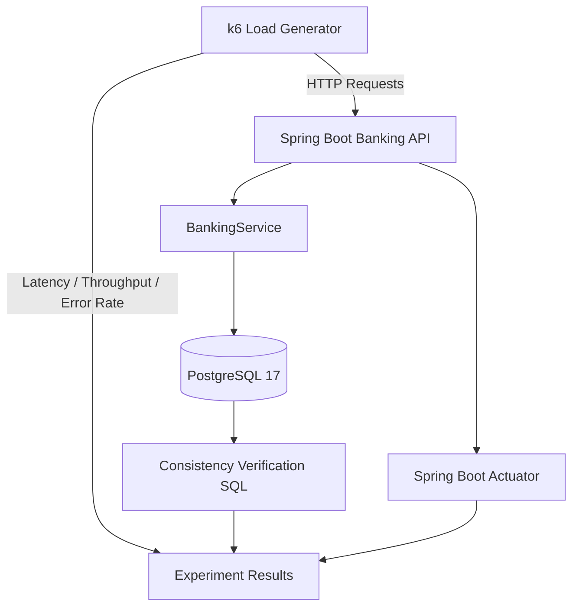

# Banking Reliability Lab

> **기술 스택:** Java 21, Spring Boot 4.2.0, PostgreSQL 17, Docker Compose, k6, Spring Boot Actuator, Micrometer

## 1. 개요

### 1.1. 배경

금융서비스는 높은 처리량과 빠른 응답속도뿐만 아니라 거래 데이터의 정확성을 보장해야 한다.

특히 동일 계좌에 다수의 이체 요청이 동시에 발생할 경우, 잘못된 동시성 제어는 잔액 불일치나 중복 이체 등의 문제로 이어질 수 있다.

KokoaBank의 Banking Service에는 PostgreSQL 트랜잭션, 행 단위 잠금, 멱등성 키 기반 중복 요청 방지 기능을 구현하였다.

본 실습에서는 해당 기능이 동시 요청 환경에서도 정확하게 작동하는지 검증하고, 부하 증가에 따른 응답시간과 처리량의 변화를 측정한다.

### 1.2. 목표

- k6 기반 재현 가능한 금융거래 부하 테스트 환경 구축
- 계좌이체 100건 처리 시 응답시간 및 처리량 측정
- 동일 멱등성 키를 사용한 중복 요청 30건 검증
- 송금·수취 계좌의 최종 잔액 및 거래 원장 정합성 확인
- Spring Boot 메트릭 기반 성능 병목 분석 환경 구성
- 후속 성능 개선 및 장애 대응 실험을 위한 기준선 확보

본 프로젝트는 실제 금융거래가 발생하지 않는 시뮬레이션 환경이다.

## 2. 시스템 아키텍처

### 2.1. 구성 요소

| 구성 요소 | 역할 |
|---|---|
| k6 | 가상 사용자 기반 HTTP 부하 생성 및 성능 지표 측정 |
| Banking API | 인증·인가 및 계좌이체 요청 처리 |
| BankingService | 트랜잭션·잔액 검증·멱등성 처리 |
| PostgreSQL | 계좌 잔액, 이체 내역 및 거래 원장 저장 |
| Actuator / Micrometer | HTTP 요청 및 JVM 메트릭 제공 |
| 검증 SQL | 실제 데이터의 금융거래 정합성 검사 |

### 2.2. 테스트 대상

기존 Banking API를 수정하지 않고 실제 HTTP 인터페이스를 호출하도록 구성하였다.

주요 API는 다음과 같다.

| Method | Endpoint | 용도 |
|---|---|---|
| GET | `/api/auth/me` | 세션 인증 및 사용자 권한 확인 |
| GET | `/api/auth/csrf` | CSRF 토큰 발급 |
| POST | `/api/banking/accounts` | 실험용 계좌 생성 |
| POST | `/api/banking/dev/fund` | 로컬 테스트 자금 지급 |
| POST | `/api/banking/transfers` | 계좌이체 |
| GET | `/api/banking/accounts/{id}` | 최종 잔액 확인 |
| GET | `/api/banking/transactions` | 거래 원장 조회 |

테스트용 자금 지급 API는 로컬 프로필에서만 활성화하며 운영자 또는 관리자 권한을 요구한다.

## 3. 기술적 의사결정

### 3.1. k6를 선택한 이유

금융 API에 대해 동시 HTTP 요청을 생성하고 응답시간 분포, 요청 처리량, 오류율을 측정할 수 있는 부하 테스트 도구가 필요하였다.

k6는 JavaScript 기반 테스트 시나리오를 코드로 관리할 수 있고, 가상 사용자 수와 반복 횟수를 명시적으로 설정할 수 있다.

또한 Threshold를 활용하여 실험의 성능 조건을 자동으로 판정할 수 있다.

따라서 테스트 시나리오의 재현성, Git 기반 버전 관리, 향후 CI 파이프라인 통합 가능성을 고려하여 k6를 선택하였다.

### 3.2. 실제 Banking API를 호출한 이유

테스트 전용 인증 우회 API나 별도 계좌이체 구현을 만들 경우 실제 서비스와 다른 경로를 검증하게 된다.

따라서 기존 카카오 OAuth2 세션 인증과 CSRF 보호를 유지한 상태에서 실제 Banking API를 호출하도록 구성하였다.

이를 통해 인증 필터, Controller, Service, PostgreSQL까지 포함한 요청 처리 경로를 측정할 수 있다.

단, 해당 방식은 실제 운영환경의 사용자 인증 부하를 재현하는 것이 아니라 인증된 세션을 재사용한 금융 API 처리 성능을 측정한다.

### 3.3. PostgreSQL 행 단위 잠금

동일한 계좌에 대한 동시 이체에서는 여러 요청이 잔액을 동시에 읽고 수정할 수 있다.

BankingService에서는 `SELECT FOR UPDATE`를 활용하여 계좌 행에 잠금을 획득하도록 구현하였다.

또한 송금 계좌와 수취 계좌를 ID 순서대로 잠가 잠금 획득 순서를 일관되게 유지하였다.

이를 통해 경쟁 상태를 방지하고 교착상태 발생 가능성을 줄이고자 하였다.

행 단위 잠금은 정합성을 보장하기 위한 선택이지만, 동일 계좌에 요청이 집중되면 처리량 제한과 대기시간 증가를 유발할 수 있다.

따라서 이번 실험에서는 잠금에 의한 직렬화 가능성을 주요 분석 대상으로 설정하였다.

### 3.4. 멱등성 키 적용

계좌이체 요청은 네트워크 지연이나 응답 유실로 재전송될 수 있다.

동일한 요청을 재처리하면 실제 의도보다 여러 번 계좌 잔액이 변경될 위험이 있다.

이를 방지하기 위해 클라이언트가 `Idempotency-Key`를 전달하고, PostgreSQL의 UNIQUE 제약조건으로 동일 키의 중복 등록을 차단하도록 구현하였다.

이미 완료된 동일 요청은 기존 이체 결과를 반환하도록 설계하였다.

단순히 HTTP 응답이 성공했는지뿐만 아니라 실제 `transfers` 및 `transactions` 데이터가 중복 생성되지 않았는지 검증한다.

## 4. 실험 환경

### 4.1. 기술 환경

| 항목 | 구성 |
|---|---|
| OS | macOS |
| Runtime | Java 21 |
| Backend | Spring Boot 4.2.0 |
| Database | PostgreSQL 17 |
| Container | Docker Compose |
| Load Testing | k6 |
| Metrics | Spring Boot Actuator / Micrometer |

### 4.2. 실행 환경 기록

실제 측정 결과의 재현성을 위해 다음 항목을 기록한다.

| 항목 | 측정값 |
|---|---|
| CPU | Apple M5 |
| 메모리 | 25769803776 Bytes |
| k6 버전 | k6 v2.4.0 (commit/devel, go1.27.4, darwin/arm64) |
| PostgreSQL 버전 | postgres (PostgreSQL) 17.12 |
| Java 버전 | 21 |
| HikariCP 최대 연결 수 | 실행 후 기록 |
| 테스트 실행 일시 | 실행 후 기록 |

부하 테스트 결과는 CPU·메모리 사용량, 네트워크 상태, DB 커넥션 수, JVM 워밍업 등에 영향을 받을 수 있다.

따라서 성능 비교 시 동일한 실험 조건을 유지해야 한다.

## 5. 실험 1 — 동시 계좌이체 부하 테스트

### 5.1. 목적

다수의 요청이 동일 계좌에서 이체를 실행할 때 응답시간 및 처리량을 측정하고, 최종 계좌 잔액과 거래 원장이 일관되게 기록되는지 검증한다.

### 5.2. 실험 조건

| 항목 | 설정 |
|---|---:|
| Virtual Users | 20 |
| 총 이체 요청 | 100건 |
| 요청당 이체 금액 | 1,000원 |
| 초기 송금 계좌 잔액 | 200,000원 |
| 초기 수취 계좌 잔액 | 0원 |
| 실행기 | `shared-iterations` |

모든 요청에 서로 다른 멱등성 키를 사용한다.

### 5.3. 기대 결과

정상적으로 100건의 이체가 완료되면 다음 상태가 되어야 한다.

- 성공 이체: 100건
- 송금 계좌 잔액: 100,000원
- 수취 계좌 잔액: 100,000원
- 두 계좌 잔액 합계: 200,000원
- 송금 원장: 100건
- 수취 원장: 100건

### 5.4. 성능 측정 지표

| 지표 | 측정 목적 |
|---|---|
| 평균 응답시간 | 전반적인 요청 처리 지연 |
| P95 응답시간 | 상위 지연 구간 분석 |
| 최대 응답시간 | 최악 지연 사례 확인 |
| 초당 처리량 | 단위 시간당 완료된 이체 수 |
| 실패율 | 오류 및 실패 요청 비율 |
| 금융거래 정합성 | 계좌 잔액 및 거래 원장의 일관성 |

초기 성능 임계값은 이체 성공률 100%, P95 3,000ms 미만으로 설정하였다.

해당 기준은 측정 전에 설정한 실험 목표이며, 실제 달성 결과를 의미하지 않는다.

## 6. 실험 2 — 멱등성 동시 요청 검증

### 6.1. 목적

동일한 계좌이체 요청이 여러 번 도착하더라도 실제 금융거래가 한 번만 처리되는지 검증한다.

### 6.2. 실험 조건

| 항목 | 설정 |
|---|---:|
| Virtual Users | 30 |
| 총 요청 수 | 30건 |
| 멱등성 키 | 동일 값 |
| 이체 금액 | 10,000원 |
| 기대 실제 이체 | 1건 |
| 기대 중복 응답 | 29건 |

### 6.3. 기대 결과

정상적인 경우 최초 요청 한 건만 실제 계좌이체를 수행하고, 나머지 요청은 기존 이체 결과를 반환해야 한다.

- 실제 이체: 1건
- 송금 계좌 출금 원장: 1건
- 수취 계좌 입금 원장: 1건
- 총 차감 금액: 10,000원
- 중복 이체로 인한 추가 차감: 0원

`shared-iterations`를 사용하여 여러 가상 사용자가 요청을 수행하지만, 모든 요청이 완전히 같은 시각에 도착하는 것을 보장하지는 않는다.

따라서 결과는 동시 부하 상황의 멱등성 검증으로 해석하며, 엄밀한 경쟁 조건 검증은 별도 동기화 기법으로 보완할 수 있다.

## 7. 데이터 정합성 검증

성능 테스트가 성공했더라도 금융 데이터가 정확하다는 사실을 별도로 확인해야 한다.

### 7.1. 계좌 잔액 보존

두 계좌 간 내부 이체만 실행하므로 이체 전후의 계좌 잔액 합계는 변하지 않아야 한다.

\[
B_{\mathrm{sender}} + B_{\mathrm{receiver}} = B_{\mathrm{initial}}
\]

정상 이체 100건 실험에서는 초기 합계인 200,000원이 유지되어야 한다.

### 7.2. 이체 원장 정합성

완료된 이체마다 출금 원장과 입금 원장이 각각 한 건씩 존재해야 한다.

또한 두 원장의 금액은 해당 이체 금액과 일치해야 한다.

### 7.3. 중복 처리 방지

동일 멱등성 키를 가진 요청에 대해 실제 이체 레코드가 한 건만 존재해야 한다.

동일 키 UNIQUE 제약조건과 서비스 수준의 요청 내용 비교를 함께 검증한다.

### 7.4. 검증 방식

k6의 `teardown()` 단계에서 계좌 잔액 및 거래내역을 조회하고, PostgreSQL SQL 쿼리로 DB 레코드를 직접 확인한다.

두 방식의 결과가 일치해야 정합성 검증을 완료한 것으로 판단한다.

## 8. Observability

### 8.1. Actuator 및 Micrometer

Spring Boot Actuator를 활용하여 HTTP 요청 메트릭과 JVM 상태를 확인하도록 구성한다.

주요 관찰 항목은 다음과 같다.

- HTTP 요청 횟수 및 응답시간
- HTTP 상태 코드별 요청 분포
- JVM 메모리 사용량
- JVM 스레드 상태
- 프로세스 CPU 사용량

### 8.2. 분석 방향

부하 증가로 응답시간이 증가할 경우 다음 순서로 원인을 분석한다.

1. HTTP 오류 및 타임아웃 발생 여부 확인
2. P95 및 최대 응답시간 변화 확인
3. DB 계좌 행 잠금 경합 여부 확인
4. HikariCP 커넥션 풀 사용 현황 확인
5. JVM 및 시스템 자원 사용량 확인
6. 변경 전후 동일 조건에서 재실험

메트릭의 실제 수집·시각화를 자동화하는 작업은 이후 Observability 구성 단계에서 확장한다.

## 9. 실험 결과

### 9.1. 정상 이체 부하 테스트

| 지표 | 목표·기대값 | 실제 결과 |
|---|---:|---|
| 요청 수 | 100건 | 미측정 |
| 성공 이체 | 100건 | 미측정 |
| 평균 응답시간 | 측정 | 미측정 |
| P95 응답시간 | 3,000ms 미만 | 미측정 |
| 최대 응답시간 | 측정 | 미측정 |
| 처리량 | 측정 | 미측정 |
| 실패율 | 0% | 미측정 |
| 잔액 합계 | 200,000원 | 미검증 |
| 원장 정합성 | 불일치 0건 | 미검증 |

### 9.2. 멱등성 테스트

| 지표 | 목표·기대값 | 실제 결과 |
|---|---:|---|
| 전체 요청 | 30건 | 미측정 |
| 실제 이체 | 1건 | 미검증 |
| 중복 응답 | 29건 | 미측정 |
| 추가 차감 | 0원 | 미검증 |
| 원장 중복 | 0건 | 미검증 |

### 9.3. 관찰된 문제 및 원인

실험 수행 후 실제 관찰된 문제를 기록한다.

- 발생 조건:
- 증상:
- 관련 로그 및 메트릭:
- 원인:
- 수정 사항:
- 개선 후 재측정 결과:

## 10. 향후 개선

이번 실습은 단일 Spring Boot 인스턴스와 단일 PostgreSQL 데이터베이스를 중심으로 한다.

다음 항목은 추가 검증이 필요하다.

- 다양한 VU 수와 부하 수준에 따른 처리량 비교
- 장시간 부하에서의 지연시간 및 오류율
- DB 커넥션 풀 고갈 상황
- PostgreSQL 잠금 대기 및 교착상태 분석
- 서버 종료·재시작 시 금융거래 복구
- 응답 유실 후 멱등성 재요청 검증
- Kubernetes 다중 인스턴스 환경에서의 요청 처리
- Prometheus·Grafana 기반 메트릭 수집 및 대시보드
- Kafka 기반 비동기 처리 시 데이터·이벤트 정합성

## 11. 결론

본 실습에서는 Banking Service의 신뢰성을 검증하기 위해 k6 기반 금융거래 부하 테스트 환경과 PostgreSQL 정합성 검증 절차를 구성하였다.

계좌이체 처리 성능과 멱등성 동작을 각각 독립적인 실험으로 분리하고, HTTP 요청 결과와 실제 데이터베이스 상태를 함께 검증하도록 설계하였다.

실측한 성능 결과와 발견한 문제는 향후 동일 문서에 기록하여 개선 전후의 변화를 비교한다.

해당 실험 환경은 이후 CI/CD 파이프라인의 성능 회귀 검사와 Kubernetes 기반 장애 대응 실습으로 확장할 수 있다.